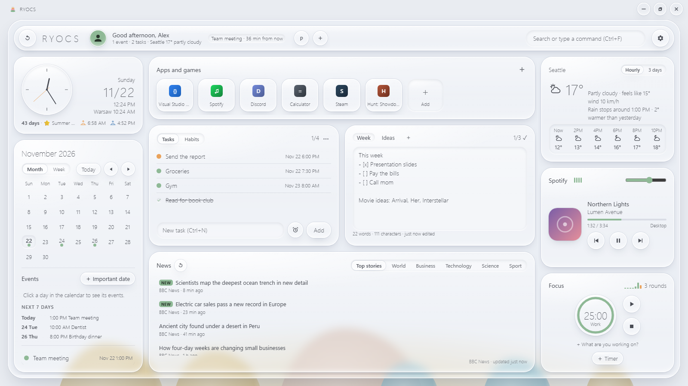

# RYOCS

A personal dashboard for Windows: clock, calendar, tasks, notes, weather, news, Spotify, focus timer and more, on one neumorphic screen that lives in the tray.

RYOCS is a small native app (Rust + WebView2). Your data stays on your computer in `%APPDATA%\RYOCS`; nothing is sent anywhere except the services you connect yourself.

The interface is in **English** and **Turkish**. It follows the Windows display language and can be changed in Settings → General → Language.

**[Project page](https://ryocs15.github.io/ryocs/)** · **[Download](https://github.com/ryocs15/ryocs/releases/latest)**


## Screenshots

| Dark theme | Search everything |
| --- | --- |
|  |  |
| **Themes** | **Glass look** |
|  |  |

*Screenshots use demo data.*

## Features

- **Clock** with several dial styles, a second time zone, sunrise/sunset and countdowns
- **Google Calendar**: month and week views, events, birthdays and important dates, regional holidays
- **Tasks and habits** with reminders, repeats (daily, weekdays, weekly, monthly or specific days) and streaks
- **Notes** with checklists
- **Weather** from Open-Meteo: hourly and 7-day forecast, morning rain/frost alerts
- **News**: BBC News in English, Bundle and TRT Haber in Turkish; keyword filter and hidden sources
- **Spotify** now playing, controls and up next
- **Focus timer** (pomodoro) with daily goal, streak and *do not disturb* (notifications wait until the round ends)
- **Gmail** unread mail (read-only)
- **Currency and gold** (ECB rates in English, TCMB in Turkish), **system** info, **clipboard history**
- Quick search and command palette (Ctrl+F), app and game launcher, quick links
- Drag cards to move them, drag the gaps between them to resize; save and restore layouts
- 12 themes, glass look, animated backgrounds, PIN lock
- Optional OneDrive sync between two computers, daily backups, JSON export/import

## Install

Download `RYOCS-Setup-x.y.z.exe` from [Releases](https://github.com/ryocs15/ryocs/releases) and run it. It installs for the current user only (no admin rights) and needs Windows 10 or 11 with the WebView2 runtime (included in Windows 11).

The installer is not code-signed yet, so Windows SmartScreen may warn on first run: choose *More info → Run anyway*.

## Connecting accounts

Google Calendar, Gmail and Spotify use your own developer credentials, which stay on your computer (`%APPDATA%\RYOCS\config.json`). RYOCS walks you through the setup in **Settings → Accounts**:

- **Google**: create a Google Cloud project, enable the *Google Calendar API* (and the *Gmail API* for the mail card), create a *Desktop app* OAuth client and paste its ID and secret. Gmail access is read-only.
- **Spotify**: create an app in the Spotify for Developers dashboard and paste its Client ID. Playback control needs Spotify Premium.

Weather, news and currency rates need no account.

## Build from source

Requirements: Windows, [Rust](https://rustup.rs) (stable, MSVC toolchain) and, for the installer, [Inno Setup 6](https://jrsoftware.org/isinfo.php).

```bash
cargo test --release
cargo build --release
"C:\Program Files (x86)\Inno Setup 6\ISCC.exe" kurulum\ryocs.iss
```

The app is `target\release\ryocs.exe`; the installer is written to `target\kurulum\`. The whole UI is a single file, `src/ui.html`, served by the app on `127.0.0.1:8765`. A self-check for the repeat logic runs with `node test_sonraki.js`.

Pushing a tag such as `v0.3.0` builds the installer on GitHub Actions and attaches it to a release.

## Privacy

- Data, credentials and tokens are stored only in `%APPDATA%\RYOCS`.
- The local server answers only requests from its own page.
- Clipboard history is kept in memory only and skips content that password managers mark as private.
- The PIN lock is a privacy screen; `data.json` itself is not encrypted.

## License

[MIT](LICENSE)
