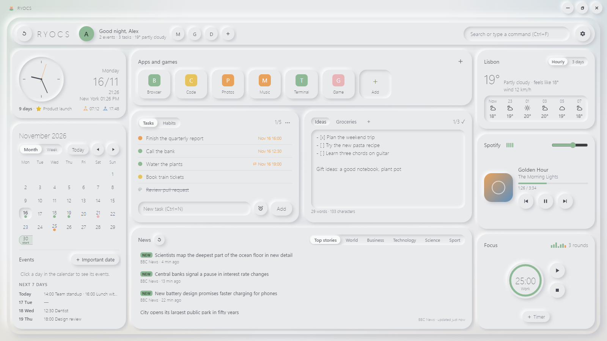
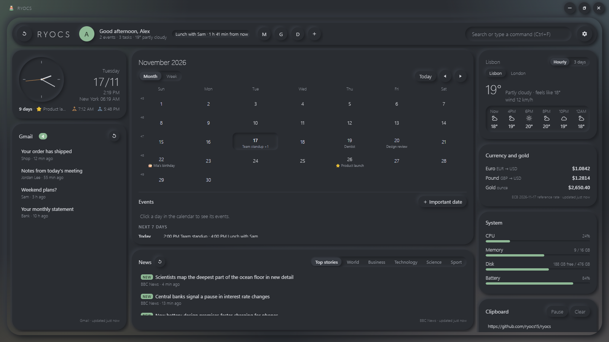
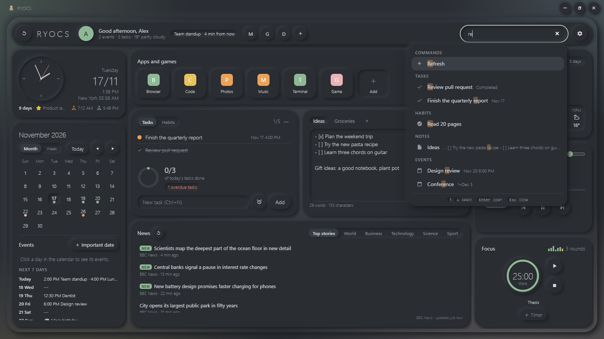
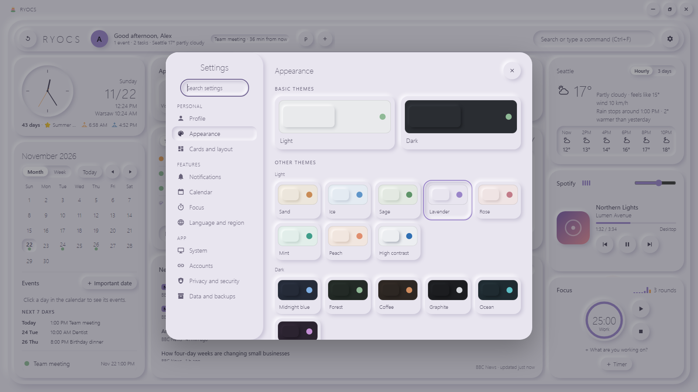
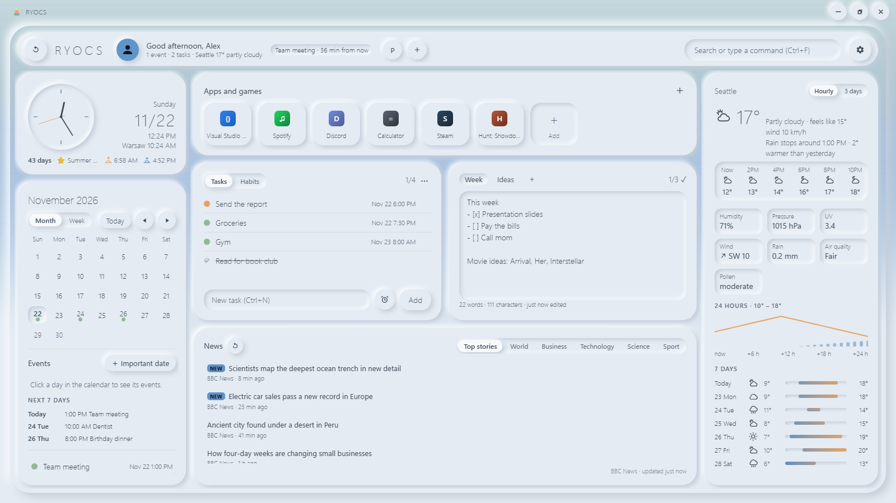
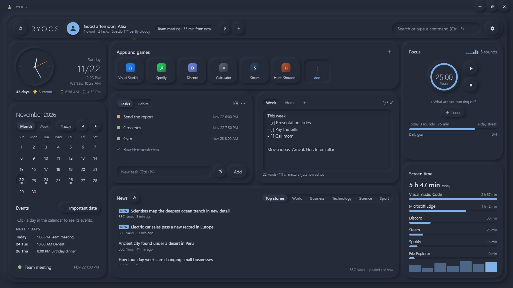

# RYOCS

A personal dashboard for Windows: clock, calendar, tasks, notes, weather, news, Spotify, focus timer and more, on one neumorphic screen that lives in the tray.

RYOCS is a small native app (Rust + WebView2). Your data stays on your computer in `%APPDATA%\RYOCS`; nothing is sent anywhere except the services you connect yourself.

The interface is in **English** and **Turkish**. It follows the Windows display language and can be changed in Settings → Language and region. Time format (12/24 h), the first day of the week, weather units (°C/°F) and public holidays follow your region and can be changed in each card's settings.

**[Project page](https://ryocs15.github.io/ryocs/)** · **[Download](https://github.com/ryocs15/ryocs/releases/latest)** · [What's new](CHANGELOG.md)



## Screenshots

| Dark theme | Search everything |
| --- | --- |
|  |  |
| **Themes** | **Glass look** |
|  |  |
| **Weather, made large** | **Screen time** |
|  |  |

*Screenshots use demo data.*

## Features

- **Clock** with several dial styles, alarms, a second clock (about 35 cities), sunrise/sunset, countdowns, a free timer you can pause and a stopwatch
- **Google Calendar**: month and week views, add, edit and delete events, birthdays and important dates, regional holidays
- **Tasks and habits** with reminders (type "tomorrow 15:00" at the end of a task), snooze, repeats (daily, weekdays, weekly, monthly or specific days), subtasks and streaks
- **Notes** with checklists
- **Weather** from Open-Meteo for up to five cities (switch in the card; when several places share a name you pick the right one): hourly and 7-day forecast (click a day for its hours), when rain starts or stops, the difference from yesterday, air quality and pollen, a morning alert (rain, frost, storms, snow, wind, heat, poor air) and an evening note for tomorrow
- **News**: BBC News in English, Bundle in Turkish, and breaking news from seven Turkish outlets in one list (the same story from several outlets is one row); a small dot marks what came since you last looked; keyword filter, hidden sources, save for later
- **Spotify** now playing (podcasts too), controls, seeking, shuffle and repeat, moving playback to another device, and up next
- **Focus timer** (pomodoro) with long breaks, skipping a round or adding 5 minutes (right-click), daily goal, streak, your own labels, a *what am I working on* note with a weekly breakdown, and *do not disturb* (notifications wait until the round ends)
- **Gmail** last 15 inbox messages, unread ones in bold, a notification for new mail; right-click to mark as read or unread, or to archive; extra Gmail accounts (Settings → Accounts → Add account) show together or one at a time
- **Currency and gold** with a converter and rate, gold and silver alerts, in your home currency (about 160 currencies; TCMB for TRY, ECB and world rates otherwise), **system** info (CPU with its last minute, memory, every drive, battery time left, uptime), **clipboard history** (pinned items are kept, encrypted; delete)
- **Screen time**: how long you spent in each program today and on each of the last 7 days, a daily average, your own names for programs, hidden programs, a daily limit per program with a notification 10 minutes before and when it is passed, and a **weekly summary** of focus, tasks, habits and screen time every Sunday evening (off until you open the card; measured on this PC only)
- Quick search and command palette (Ctrl+F), app and game launcher, quick links with site icons, search in Settings
- Lives in the tray with a global shortcut you can choose; remembers its window size and position
- Drag cards to move them, drag the gaps between them to resize; cards fill the free space or fit their content; save and restore layouts
- 16 themes, glass look, 11 animated backgrounds (lava lamp, snow, fireflies, aurora…) or a random one each time, PIN lock
- Optional OneDrive sync between two computers, daily backups, JSON export/import
- Update check: a notice with a download link when a new version is on GitHub (nothing is installed by itself)

## Install

Download `RYOCS-Setup-x.y.z.exe` from [Releases](https://github.com/ryocs15/ryocs/releases) and run it. It installs for the current user only (no admin rights) and runs on Windows 10 (1709 or later) and 11. Nothing else needs to be installed: the Visual C++ runtime and the Poppins font are inside the app, and the installer adds Microsoft's WebView2 Runtime when the PC lacks it (included in Windows 11; this one step needs an internet connection).

The installer is not code-signed yet, so Windows SmartScreen may warn on first run: choose *More info → Run anyway*.

## Connecting accounts

Weather, news, currency rates, notes, tasks and the focus timer work right away. You only need this section if you want to see your **Google Calendar**, **Gmail** or **Spotify** inside RYOCS.

### Why is there a setup step?

RYOCS is a small free app, not a company with its own Google or Spotify account. So instead of signing in through *our* key, you create your **own free key** once. It sounds technical, but it is just filling in a few forms, and it takes about 10 minutes for Google and 3 minutes for Spotify.

A few words you will see:

- **Client ID / Client secret**: a username and password for the *app*, not for you. They tell Google or Spotify that the requests come from your copy of RYOCS.
- **Project / app**: just a folder on Google's or Spotify's website that holds this key.
- **Permission (consent) screen**: the page where Google or Spotify asks *"Do you allow RYOCS to see your calendar?"*. You click **Allow** once.

It is free, it needs no credit card, and the key stays on your computer in `%APPDATA%\RYOCS\config.json`. Nobody else, including the RYOCS developers, can see it.

> 💡 Inside RYOCS, **Settings → Accounts → Set up and connect** opens a window with the same steps and buttons that open the right pages for you. You can follow that window instead of this guide.

### Google Calendar and Gmail

**Part 1: create your key on Google's website**

1. Open **[console.cloud.google.com](https://console.cloud.google.com)** and sign in with the Google account whose calendar you want to see. If it asks you to accept the terms, accept them.
2. **Create a project.** At the top of the page, click the project picker (next to the *Google Cloud* logo) → **New project**. Name it `RYOCS` → **Create**. Wait a few seconds until the top bar shows *RYOCS*.
3. **Turn on the calendar.** Open **[Google Calendar API](https://console.cloud.google.com/apis/library/calendar-json.googleapis.com)** and click **Enable**.
   For the mail card, also open **[Gmail API](https://console.cloud.google.com/apis/library/gmail.googleapis.com)** and click **Enable**.
4. **Set up the permission screen.** Open **[Google Auth Platform](https://console.cloud.google.com/auth/overview)** → **Get started**:
   - *App name*: `RYOCS`, *User support email*: your e-mail → **Next**
   - *Audience*: choose **External** → **Next**
   - *Contact information*: your e-mail → **Next**
   - Tick the agreement → **Create**
5. **Add yourself as a tester.** In the left menu click **Audience** → under *Test users* click **Add users** → type your own Gmail address → **Save**.
6. **Create the key.** In the left menu click **Clients** → **Create client**:
   - *Application type*: **Desktop app**
   - *Name*: `RYOCS` → **Create**
   - In the window that appears, click **Download JSON**. This file is your key. Keep it; do not share it.

**Part 2: give the key to RYOCS**

7. In RYOCS open **Settings** (the gear icon, or Ctrl+,) → **Accounts** → next to *Google Calendar* click **Set up and connect**.
8. Click **Choose the downloaded JSON file…** and pick the file from step 6. (Or copy the *Client ID* and *Client secret* by hand.) → **Save and connect**.
9. Your browser opens. Choose your Google account.
10. Google shows **"Google hasn't verified this app"**. This is normal: the "app" is the key you made yourself a minute ago. Click **Advanced** → **Go to RYOCS (unsafe)**.
11. Tick all the boxes (calendar, and mail if you want the Gmail card) → **Continue**.
12. The page says **"Google Calendar connected"**. Close the tab and go back to RYOCS. Your calendar appears within a few seconds.

**Good to know**

- **Signed out after a week?** While the key is in *Testing* mode, Google asks you to sign in again every 7 days. To stop this, go to **Audience** → **Publish app** → **Confirm**. You do not need Google to review anything: you are the only user.
- **Gmail card says "Update permission"?** You connected before the Gmail card existed, or before marking as read was added. Click **Update permission** on the card and allow mail access in the browser.
- **"Access blocked" or "Error 403: access_denied"?** Your address is not in the test users list. Repeat step 5.
- **Gmail card says the API is turned off?** Repeat the Gmail part of step 3.
- RYOCS reads your mail and can mark it read or unread and archive it. It cannot send or delete anything.
- **More Gmail accounts:** add each one as a test user (step 5), then **Settings → Accounts → Add Gmail**. They are for mail only; the calendar stays with the main account.

### Outlook / Hotmail (optional)

Outlook needs its own free key from Microsoft, made the same way:

1. Open **[Azure → App registrations](https://portal.azure.com/#view/Microsoft_AAD_RegisteredApps/ApplicationsListBlade)**, sign in with your Microsoft account and click **New registration**.
2. *Name*: `RYOCS`. *Supported account types*: **Accounts in any organizational directory and personal Microsoft accounts**.
3. *Redirect URI*: platform **Public client/native (mobile & desktop)**, address (copy it exactly), then **Register**:
   ```
   http://localhost:8765/callback/microsoft
   ```
4. **Authentication → Advanced settings → Allow public client flows: Yes → Save.**
5. **API permissions → Add a permission → Microsoft Graph → Delegated permissions → Mail.ReadWrite → Add permissions.**
6. Copy the **Application (client) ID** from the *Overview* page. No secret is needed.
7. In RYOCS open **Settings → Accounts → Add Outlook**, paste the ID → **Save and connect**, choose your account in the browser and accept.

Outlook mail shows on the mail card next to your Gmail accounts; Outlook alone works too, without Google. A work or school account may need your organisation's admin to allow the app. Right-click an account's button on the card to give it your own colour.

### Spotify

1. Open **[developer.spotify.com/dashboard](https://developer.spotify.com/dashboard)** and log in with your normal Spotify account. Accept the terms if asked.
2. Click **Create app** and fill in:
   - *App name*: `RYOCS`, *App description*: anything, for example `My dashboard`
   - *Redirect URI*: copy this exactly, then click **Add**:
     ```
     http://127.0.0.1:8765/callback/spotify
     ```
   - *Which API/SDKs are you planning to use?*: tick **Web API**
   - Tick the agreement → **Save**
3. On the app page click **Settings** and copy the **Client ID** (a 32-character code). You do **not** need the client secret.
4. In RYOCS open **Settings → Accounts** → next to *Spotify* click **Set up and connect**, paste the Client ID → **Save and connect**.
5. Your browser opens: click **Agree**. Close the tab and go back to RYOCS.

Start a song on any device (phone, PC, speaker) and it shows up on the Spotify card. Seeing what is playing works with a free account; **play, pause, skip and volume need Spotify Premium** (a Spotify rule).

### Disconnecting

**Settings → Accounts → Disconnect** removes the sign-in from RYOCS. To remove the key completely, also delete the project on Google Cloud or the app on the Spotify dashboard.

Weather, news and currency rates need no account.

## Build from source

Requirements: Windows, [Rust](https://rustup.rs) (stable, MSVC toolchain) and, for the installer, [Inno Setup 6](https://jrsoftware.org/isinfo.php).

```bash
cargo test --release
cargo build --release
"C:\Program Files (x86)\Inno Setup 6\ISCC.exe" kurulum\ryocs.iss
```

The app is `target\release\ryocs.exe`; the installer is written to `target\kurulum\`. The whole UI is a single file, `src/ui.html`, served by the app on `127.0.0.1:8765`.

Tests (they also run on every push):

```bash
cargo test --release
node tests/sonraki.test.js
python tests/ui/calis.py
```

`tests/ui/calis.py` opens the UI in headless Microsoft Edge with demo data and runs the `tests/ui/*.test.js` files; `tests/fixtures/` holds saves from older versions that must keep opening. The data files are described in [docs/DATA.md](docs/DATA.md).

Pushing a tag such as `v0.3.0` builds the installer on GitHub Actions and attaches it to a release.

## Privacy

- Data, credentials and tokens are stored only in `%APPDATA%\RYOCS` ([what is in each file](docs/DATA.md)).
- The local server answers only requests from its own page.
- Screen time is measured only while its card is open, stays in `ekran.json` on this PC (encrypted, not synced) and can be deleted from the card's right-click menu.
- Clipboard history is kept in memory and skips content that password managers mark as private; only the items you pin are stored, in `pano.json` (encrypted).
- `data.json`, its backups and the client secrets are encrypted with Windows DPAPI: only your Windows account on this PC can open them. Use *Settings → Data and backups → Export* for a plain copy (moving to another PC, Windows reinstall).
- The OneDrive copy can be password-encrypted (*Settings → Data and backups → Password…*); without a password it is plain JSON.
- The PIN lock is a privacy screen on top of that.
- The installer is not code-signed yet, so Windows SmartScreen may warn on first run ("More info → Run anyway").

## License

[MIT](LICENSE). The bundled Poppins font is under the [SIL Open Font License](assets/yazi/OFL.txt).
